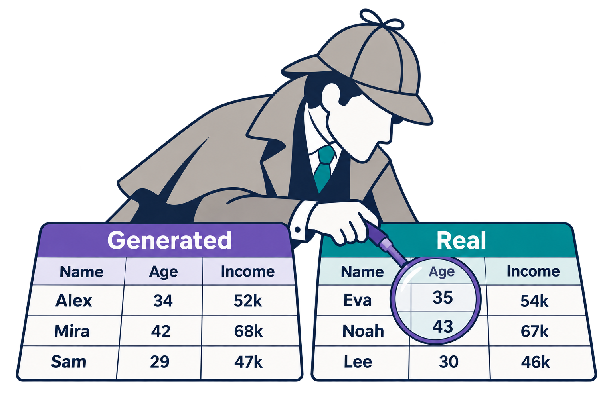

# TabGenEval

<p align="center">
  
</p>

<p align="center">
  <a href="https://www.granica.ai/large-tabular-models/tabgen-eval/index.html">
    [🌐 Documentation]
  </a>
</p>

TabGenEval is a comprehensive, high-performance evaluation framework for synthetic tabular data, using real data as the reference. It evaluates tabular generative models across three core pillars: Fidelity, Memorization, and Utility.

TabGenEval offers four key capabilities: (1) comprehensive population- and subpopulation-level evaluation, (2) real-data references, (3) uncertainty quantification, and (4) high-performance large-scale computation.

TabGenEval is the newer version of [LTM-Eval](https://github.com/granica-ai/ltm-eval).

## Available metrics

| Pillar | Metrics | What they measure |
| --- | --- | --- |
| Fidelity | [Shape](https://github.com/granica-ai/tabgen-eval/blob/main/docs/source/metrics/fidelity/shape.md), [Trend](https://github.com/granica-ai/tabgen-eval/blob/main/docs/source/metrics/fidelity/trend.md) | Individual column distributions and relationships between columns |
| Fidelity | [Conditional Shape, Conditional Trend, Recovery](https://github.com/granica-ai/tabgen-eval/blob/main/docs/source/metrics/fidelity/conditional.md) | Fidelity and representation within subpopulations |
| Fidelity | [Precision, Recall, Density, Coverage (PRDC)](https://github.com/granica-ai/tabgen-eval/blob/main/docs/source/metrics/geometric-fidelity/prdc.md) | Local geometric structure |
| Fidelity | [Linear C2ST](https://github.com/granica-ai/tabgen-eval/blob/main/docs/source/metrics/detection/linear-c2st.md), [Nonlinear C2ST](https://github.com/granica-ai/tabgen-eval/blob/main/docs/source/metrics/detection/nonlinear-c2st.md) | How well classifiers can distinguish synthetic from real data |
| Fidelity | [Concentration](https://github.com/granica-ai/tabgen-eval/blob/main/docs/source/metrics/concentration.md) | Over-concentration of synthetic records |
| Memorization | [DCR Ratio](https://github.com/granica-ai/tabgen-eval/blob/main/docs/source/metrics/memorization/dcr.md), [Near-match Rate](https://github.com/granica-ai/tabgen-eval/blob/main/docs/source/metrics/memorization/near-match-rate.md), [Replication Ratio](https://github.com/granica-ai/tabgen-eval/blob/main/docs/source/metrics/memorization/replication-ratio.md) | Proximity to and reproduction of training records |
| Utility | [MLE, including prediction agreement](https://github.com/granica-ai/tabgen-eval/blob/main/docs/source/metrics/utility/mle.md) | Predictive performance and agreement of models trained on synthetic versus real data |

**Fast evaluation on CPU and GPU.** Across evaluation metrics, TabGenEval's optimized CPU and GPU implementations achieve average speedups of **33.4× and 90.8×**, respectively, compared to equivalent Python CPU implementations.

## Install

Requires Python 3.10 or later. Install from PyPI:

```bash
pip install tabgen-eval
```

For GPU support on Linux:

```bash
pip install "tabgen-eval[cuda,xgboost-cuda]"
```

Supported platforms are Linux (CPU and GPU) and Apple Silicon macOS (CPU only).
Native CPU operators compile on first use and require a C++17-compatible compiler
(C++20 for PyTorch ≥ 2.12) and OpenMP support. See the
[installation guide](https://www.granica.ai/large-tabular-models/tabgen-eval/getting-started/installation.html)
for compiler setup and source installation instructions.

## Quick Start

### 1. Prepare evaluation data

Load the holdout real data and generated data as Pandas DataFrames, define the table schema, and construct an `EvalData` container. The following example uses an illustrative schema for the `adult` dataset.

```python
import pandas as pd
from tabgen_eval import EvalData, Schema

# Load real and generated data
holdout = pd.read_csv("holdout.csv")
generated = pd.read_csv("generated.csv")

# Define the table schema
schema = Schema(
    numeric=["age", "income"],
    categorical=["region", "outcome"],
    target="outcome",
)

# Construct the evaluation data container
eval_data = EvalData(
    test=holdout,
    generated=generated,
    schema=schema,
)
```

### 2. Run evaluation

Evaluate the generated data with a single call to `evaluate()`. Specify the desired metrics and uncertainty estimation settings, then inspect, save, or visualize the results.

```python
from tabgen_eval import evaluate

# Run evaluation with uncertainty quantification
report = evaluate(
    eval_data,
    metrics=["shape", "trend", "mle"],
    uncertainty={"mode": "both", "n_replicates": 10},
    details=True,
)

# Display the evaluation summary
print(report.summary())

# Export the report as JSON
report.to_json("evaluation.json", include_replicates=True)

# Export interactive evaluation plots
report.fidelity.plot(kind="columns", metric="shape").write_html("columns.html")
report.utility.plot(kind="utility").write_html("utility.html")
```

For more details on available metrics, uncertainty quantification options, and visualization capabilities, please refer to the [documentation](https://www.granica.ai/large-tabular-models/tabgen-eval/index.html).

## Reporting Issues

We welcome bug reports, feature requests, and suggestions for improving TabGenEval! If you encounter any issues, please [open a GitHub issue](https://github.com/granica-ai/tabgen-eval/issues/new).
Your feedback helps us improve TabGenEval. Thank you for contributing!

## Citation
If you use TabGenEval in your research, please cite our repository:

```bibtex
@software{tabgeneval2026,
  author = {Granica Research Team},
  title = {On the Evaluation of Tabular Generative Models},
  year = {2026},
  url = {https://github.com/granica-ai/tabgen-eval},
  note = {GitHub repository}
}
```

A technical report describing TabGenEval is forthcoming.
